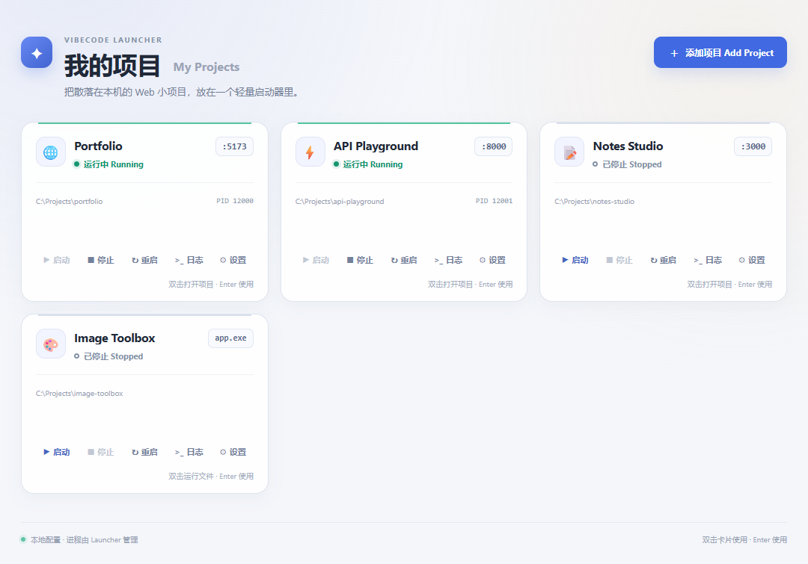

# Vibecode Project Launcher

[](https://github.com/Iterating0/vibecode-project-launcher/actions/workflows/ci.yml)

一个 Windows 本地项目启动器：添加项目文件夹，选择浏览器部署或可执行文件部署，双击卡片使用项目。

适合同时维护多个本地 Web 项目和桌面工具的个人开发者，把重复输入启动命令、找端口、查看日志和清理残留进程放进一个窗口。



*界面截图使用虚构项目与模拟状态，不包含真实项目数据。*

## 功能概览

- **项目卡片**：添加、配置、启动、停止、重启，以及查看 stdout / stderr 日志。
- **入口识别**：识别常见 Node.js / Python / 静态网页与 Windows 程序入口，提供可编辑建议。
- **端口与就绪检查**：分配可用端口，等待本地 HTTP 服务就绪后打开浏览器。
- **进程生命周期**：使用独立 Windows Job Object 管理各项目及其子进程，停止或退出时清理。
- **本地持久化**：JSON 原子保存、旧配置兼容、有界日志，无需账号或云端服务。

采用 Tauri 2、Rust、React 和 TypeScript。主界面只有项目卡片墙，设置和日志使用弹窗；没有 Electron、路由器、组件库、数据库或终端模拟器。

这是个人实践项目，目标平台为 Windows 10/11。仓库提供源码与测试；本地进程管理功能需要构建桌面应用，GitHub Pages 无法承载这些功能。

## 开发与构建

需要 Node.js 22.12+、Rust MSVC 工具链、Visual Studio C++ 桌面开发工具和 Microsoft Edge WebView2。Windows 10/11 为目标运行环境。

```powershell
npm ci
npm run desktop
```

构建可直接运行的 Windows 程序：

```powershell
npm run desktop:build
```

输出：`src-tauri/target/release/vibecode-project-launcher.exe`。使用系统 WebView2，不捆绑完整浏览器。`npm run dev` 仅用于前端预览，管理本地进程需要桌面程序。

### 桌面双击启动最新版本

运行一次以下命令，会在当前 Windows 用户的桌面创建“Vibecode 项目启动器”快捷方式：

```powershell
powershell -NoProfile -ExecutionPolicy Bypass -File .\scripts\install-desktop-shortcut.ps1
```

快捷方式指向仓库里的 `scripts/launch-latest.ps1`，不是复制出来的 EXE。双击时脚本会比对有限的前端/Rust 源码、`.env`、Cargo/Vite/TypeScript 构建配置和 lockfile；内容未变化就直接打开现有 release，发生变化才重新构建。只有 `package.json`、`package-lock.json` 对应的依赖状态变化或 `node_modules` 缺失时才运行 `npm ci`。Node.js 和 Cargo 使用明确定位的可执行文件，MSVC 环境从 Visual Studio 安装器加载，因此桌面快捷方式不依赖 Explorer 启动时的旧 PATH。

Node.js 会从标准安装位置和 PATH 查找；自定义安装可设置用户环境变量 `VIBE_NODE_EXE`，值为 `node.exe` 的完整路径。Rust 同样支持通过 `VIBE_CARGO_EXE` 指定 `cargo.exe`。

快捷方式会隐藏 PowerShell 控制台，项目 GUI 正常显示。首次构建或更新可能需要几分钟；进程内互斥会阻止重复构建。构建日志保存在 `%LOCALAPPDATA%\VibecodeProjectLauncher\logs`，发生错误或检测到“启动器仍在运行但源码已更新”时会显示可见提示框和日志位置。构建失败时不会打开旧版程序，也不会强行关闭仍在运行的启动器或它管理的项目服务。

## 添加项目

点击“添加项目”，选择已有文件夹，启动器会自动识别入口并预填原来的启动方式表单。弹窗始终保留，所有字段都可以修改；点击“添加项目”才保存，不会自动启动。识别过程中可以选择“手动填写”，没有识别结果或读取失败时也能继续手动配置。项目路径和工作目录使用绝对路径。项目文件不会复制，启动器也不会替你安装项目依赖。

| 启动方式 | 配置内容 | 双击行为 |
| --- | --- | --- |
| 浏览器部署 | 启动命令、首选端口、URL、自动打开浏览器 | 启动服务并等待 HTTP 就绪，然后打开浏览器；已经运行时直接打开浏览器 |
| 可执行文件部署 | `.exe` / `.bat` / `.cmd` 文件、可选启动参数、工作目录 | 直接运行文件；已经运行时不重复启动 |

切换启动方式会切换对应表单，两种方式的草稿会保留。第一版已有项目自动按浏览器模式读取。

### 自动识别

- Node.js：根据 `package.json` 的 `dev` / `start` / `serve` / `preview` 脚本识别 Vite（含使用 Vite 的 React/Vue/Svelte 项目）、Next.js、Astro、Nuxt、Angular 和 Create React App。优先使用 `packageManager`，否则根据 lockfile 选择 npm、pnpm、Yarn 或 Bun。
- Python：识别 Django 的 `manage.py`，以及常见文件中的 FastAPI / Flask 顶层应用实例；优先使用项目内 `.venv` / `venv` 的 Windows Python。
- 静态网页：没有 `package.json` 且存在 `index.html` 时，建议 Python HTTP 服务。
- Windows 程序：识别根目录及常见构建目录中的 `.exe`，以及 `run` / `start` / `launch` / `dev` 命名的 `.bat` / `.cmd` 启动脚本，跳过安装、卸载等工具。

多个入口会显示在“识别结果”下拉框里，切换时重新预填启动相关字段，保留项目名称、项目路径和图标。修改现有项目设置时不会重新识别或覆盖已保存配置。

识别只读取项目根目录和 `frontend`、`client`、`web`、`backend`、`server`、`app` 等有限子目录，不执行代码、不读取 `.env`、不遍历依赖目录。每份配置/源码最多读取 256 KiB，每个入口目录最多检查 256 项，最多返回 24 个建议。

自定义脚本、复合命令、特殊端口参数或多服务工程可能需要手动调整；建议会注明识别依据和不确定项。不会仅凭框架依赖猜测应用入口。预览/生产入口需要已有构建产物，Python 和对应包管理器及项目依赖需自行准备。

### 浏览器部署

| 项目类型 | 启动命令示例 | 首选端口 |
| --- | --- | --- |
| Vite | `npm run dev -- --port {port} --strictPort` | 5173 |
| Next.js | `npm run dev -- --port {port}` | 3000 |
| FastAPI | `python -m uvicorn main:app --port {port}` | 8000 |
| 静态文件 | `python -m http.server {port} --bind 127.0.0.1` | 8000 |

命令必须与项目实际启动方式一致。Launcher 将 `{port}` 替换为分配的端口，同时可在 URL 中使用 `http://localhost:{port}`。MVP 支持本地 HTTP 地址（localhost、IPv4/IPv6 loopback），URL 的端口位置必须使用 `{port}`。可使用 emoji 作为项目图标。

自定义 `python app.py` 必须让应用读取对应端口参数，或使用 `set PORT={port} && python app.py` 并让应用读取 `PORT`。Launcher 无法改写应用内硬编码的端口。

首选端口被占用时会向后寻找可用端口。对于会自行换端口的服务器，建议启用它的严格端口模式，确保服务监听端口和卡片一致。

双击已运行的卡片只打开浏览器；双击停止的卡片会先启动服务。启动失败保留错误和日志，不打开浏览器。“自动打开浏览器”控制启动按钮；双击始终表示立即使用项目。

### 可执行文件部署

使用文件选择按钮选中项目中的程序或批处理文件，也可以直接填写完整路径；路径本身不用加引号。需要参数时在“启动参数”中填写，例如 `--config "D:\My Project\config.json"`。工作目录决定程序相对路径的基准。

此模式不分配端口、不探测 HTTP，也不由 Launcher 打开浏览器。若批处理自身启动 Web 服务或浏览器，相关行为由该脚本决定。正常退出的程序显示“已停止”，非零退出显示错误；日志、停止、重启和关闭 Launcher 后清理进程树仍然可用。批处理通过 `start` 创建的子程序在脚本结束后仍由 Launcher 管理。

启动命令以你的当前用户权限在工作目录执行，与自己运行该命令相同。只添加你愿意在本机运行的项目和命令。

## 生命周期

每个运行项目由独立 Windows Job Object 管理。Stop 终止根命令与其后代，不影响其他项目。关闭 Launcher 默认停止由它启动的全部服务。

日志保留在内存中，采用有界缓冲；不会无限增长，也不会写成越来越大的磁盘日志。项目配置保存在 `%APPDATA%\local.vibecode.project-launcher\projects.json`，修改后立即保存。配置损坏时报告错误并保留原文件，不会静默重置。

## 验证

```powershell
npm run build
npm test
npm run test:core
npm run test:fixture
```

构建桌面程序后，运行 `npm run test:native` 可验收真实 Tauri IPC、端口冲突、进程树清理与关闭窗口退出。此测试会临时打开 Launcher，创建并清理带唯一标记的验收项目。

验收用例与执行记录见 [docs/acceptance.md](docs/acceptance.md)，模块边界见 [docs/architecture.md](docs/architecture.md)。浏览器 UI 测试中的 IPC 模拟与真实 Windows 进程测试分别记录。

当前范围不包含托盘、标签、收藏、多命令项目或退出后保留服务。

## 隐私与公开范围

仓库仅包含源码、通用脚本、测试夹具和技术文档。真实项目配置、个人路径记录、环境变量文件、构建产物及本机排障记录不属于公开内容。分享日志或问题截图前，请自行检查路径、命令参数及程序输出中的敏感信息。

公开历史从整理后的源码快照开始；验收文档中的历史版本名表示开发阶段，不对应此公开仓库的 Git 标签。
